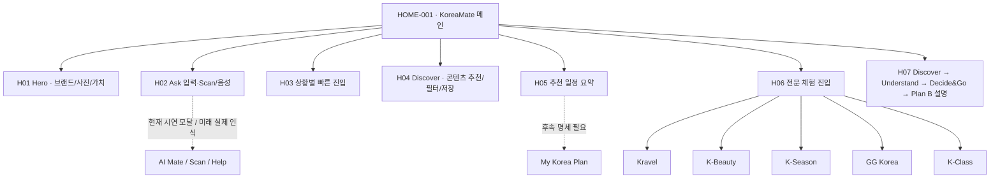

# 02 · 메인 화면설계 명세 초안 — HOME-001 / v0.9

> 이 문서는 v0.9의 **실제 HTML 화면을 기준으로 작성한 화면 명세 초안**이다. 전문 기능의 상세 명세를 완료했다고 주장하지 않는다.  
> 상태: 검토용 / 팀 합의 전 · 화면 구현 출처: [HTML](../previews/d-main-hifi-v0.9.html)

## 1. 화면 목적·대상·가장 중요한 질문

**화면 ID:** `HOME-001` · 데스크톱 메인 + 모바일 반응형.  
**1차 사용자:** 한국 문화에 관심 있는 외국인 여행 준비/여행 중 사용자.  
**1차 목적:** 새로운 한국 경험에 흥미를 느끼고, 궁금한 것을 바로 묻거나 찍을 수 있으며, 원하는 전문 경험으로 이동할 수 있다.  
**핵심 검토 질문:** '첫 화면을 5초 보고 KoreaMate가 무엇을 돕는지, 어디를 눌러야 할지 알 수 있는가?'

## 2. IA와 화면 블록 목록

| ID | 화면 영역 | 화면에 보이는 주요 요소 | 사용자 관점의 목적 | v0.9 실제 상태 |
|---|---|---|---|---|
| H01 | 상단 내비게이션 + 사진 Hero | KoreaMate 로고, 문화 사진, '한국을 더 가까이, 더 특별하게' 헤드라인, 보조 설명 | 서비스 성격과 정서적 매력 즉시 이해 | 레이아웃 완료 / 이미지 생성자산 |
| H02 | Ask·Scan 입력 | 질문 필드, 카메라, 음성, 전송 액션 | 문화/여행 문제를 직접 묻는 대표 행동 | 입력·안내 시연, 실제 LLM/비전 아님 |
| H03 | 빠른 동작 | 사진으로 물어보기, 지금 뭐 하지?, 여행 계획, Korea 101 | 무엇을 할지 정하지 못한 사용자의 시작 부담 최소화 | 진입 안내 팝업 중심 |
| H04 | Discover / 큐레이션 | 여행·음식·뷰티·공연·생활문화 탭, 이미지 카드, 저장 | 지금 관심이 가는 한국 콘텐츠 발견 | 샘플 콘텐츠·필터·하트 상태 전환 |
| H05 | 일정 요약 | '나에게 맞는 한국 여행', 체험 후보 및 일정 생성 CTA | 발견한 문화를 행동 계획으로 연결할 수 있음을 암시 | 샘플 콘텐츠/시연 안내 |
| H06 | 전문 경험 진입 | Kravel, K-Beauty, K-Season, GG Korea, K-Class 카드 | 원하는 분야에서 깊이 들어감 | 상세 서비스 완성 아님 · 안내 시연 |
| H07 | 과정 안내 | Discover, Understand, Decide & Go, Plan B | AI가 필요할 때 어떤 도움을 주는지 설명 | 개념 시각화이며 연결된 실행 단계 아님 |
| M01 | 모바일 하단 탐색 | 홈, 발견, Ask, 내 일정, 저장 | 작은 화면에서도 핵심 행동에 접근 | 반응형 표현/일부 시연 동작 |

**특히 평가할 설계 문제:** H01~H06 정보가 많아 메인의 목적이 분산되지 않는가? '서비스 모음'처럼 보이는가? Ask/Scan의 존재감이 문화 발견과 충돌하는가? 사용자가 Kravel·Beauty·Season을 '이미 동작하는 전문 서비스'로 착각하지는 않는가?

## 3. 주요 사용 흐름 (현재 데모 / 향후 설계 분리)

### F01 · 문화 콘텐츠 발견과 저장
- **현재 시연:** 메인 → Discover 카테고리 변경 → 카드 탐색 → 하트 저장/해제 → 저장 내용 안내.
- **실제 제품으로 확장:** 현재성·추천 근거·출처·관련 장소 표시, 저장한 결과가 일정/추천에 명시적 동의에 따라 반영.
- **검증 질문:** 필터 이름과 카드 정보만으로 어떤 것을 더 알아볼 수 있는지 충분히 이해되는가?

### F02 · Ask / Scan
- **현재 시연:** 질문 입력 및 빠른 액션/팝업. 이미지 업로드·카메라 실인식·마이크 STT·LLM 질의 수행은 없다.
- **목표 제품:** 질문·사진·SNS 입력 → 확인 가능한 대상 인식 → 문화 맥락과 출처 → 가능한 다음 행동/확인 질문.
- **검증 질문:** 한 화면에서 질문창, 카메라, 음성, 빠른 버튼이 서로 경쟁해 첫 행동을 헷갈리게 하지 않는가?

### F03 · 전문 서비스 직접 이용
- **현재 시연:** Kravel/Beauty/Season/GG/K-Class 카드에서 기능 가치 소개.
- **목표 제품:** Kravel 지도·코스 편집, K-Beauty 룩 전후 비교, K-Season 기간별 캘린더, K-Class 영상 학습, GG Korea 팬 코스처럼 **각자 독립적인 상세 화면**으로 전환.
- **검증 질문:** 표지 이미지·한 줄 설명만으로 각 전문 기능의 차이가 드러나는가?

### F04 · 융합된 경험의 증분 가치
- **현재 시연:** H07의 여정 설명, H05의 가상 추천 일정. 자동으로 연결된 결과는 아직 없다.
- **목표 제품:** (1) SNS 팝업 → 운영 확인 → Plan B → 일정 반영, (2) Kravel → K-Season → Kravel 일정 변경 전후 비교, (3) K-Beauty 체험 후 원하는 경우 매장 방문 연결.
- **검증 질문:** 실제 융합되지 않은 현재 메인만 보고 '이미 완전히 연결됐다'는 오해가 생기지 않는가?

## 4. PC 레이아웃·모바일 레이아웃

### PC 기준
- 화면 구조: 큰 Hero 사진 + 사진 위 실제 HTML 텍스트/검색/빠른 동작. 오른쪽 작은 콘텐츠 추천 카드.
- 이후: 밝은 배경의 추천/저장/일정 영역, 하단 전문 경험 진입, 제품 여정 설명.
- 실제 브라우저 이미지: [PC 화면](../assets/v0.9/browser-desktop-v0.9.webp). 캡처 크기는 1188×1364으로, 1440px 테스트 자체의 스크린샷과 동일하다고 가정하지 않는다.

### 모바일 기준
- Hero/Ask·Scan → 발견 카드(수평 탐색) → 전문 영역 등으로 세로 구성 재배치.
- 하단 고정 내비게이션이 별도로 노출되며, 사용자가 처음 보는 영역과 다음 스크롤의 정보량을 별도 평가해야 한다.
- 실제 브라우저 이미지: [모바일 390px](../assets/v0.9/browser-mobile-v0.9.webp). **길이가 긴 전체 캡처**이므로 390×2120 이미지의 상단 첫 화면만으로 전체 경험을 판단하지 말 것.

## 5. 화면 상태(State) 및 권한 명세 격차

| 기능 | 현재 데모 | 정식 화면설계서에서 추가 정의해야 할 상태 |
|---|---|---|
| Ask | 값 입력 및 안내 | 빈 입력, 전송 중, 답변, 실패, 출처 부족, 재질문 |
| Scan | 데모 안내 | 카메라 권한 거절, 사진 추가·제거, 흐린 이미지, 불확실한 인식, 개인정보 |
| 음성 | 아이콘/안내 | 권한, 녹음 중, 처리 중, 실패, 언어 전환, STT 확인 |
| Discover | 카테고리/하트 상태 | 데이터 없음, 로딩, 최신성/출처, 중복, 저장 동기화 실패 |
| My Korea | 가상 추천/저장 | 비로그인/로그인, 일정 충돌, 사용자 승인/취소, 삭제, 동의 설정 |
| 전문 체험 | 기능 소개/연결 안내 | 각 전문 기능의 주요 동작·입력·결과·오류·복귀 동선 |
| 모바일 | 반응형/하단 내비게이션 | 한 손 조작, 가로/세로 전환, 시스템 글꼴 확대, 키보드 등장 |

**중요:** 현재 HTML이 반응형으로 그려졌다는 사실이 접근성·사용성 검증 완료를 의미하지 않는다. 색 대비(Contrast), 키보드 이동, 포커스 표시, 스크린리더, 터치 대상(권장 최소 44px 내외)을 별도로 평가해야 한다.

## 6. 아직 없는 정식 화면 명세

메인 외 세부 화면 ID와 '화면 목적/데이터/액션/Empty·Loading·Error/모바일 대응/출처'의 개별 명세는 **미작성**이다. 이 문서는 상세 화면 설계로 개발 완료를 주장하기 위한 것이 아니라, 외부 디자인 리뷰에서 **무엇이 완성·임시·미정인지 분리**하기 위한 것이다.