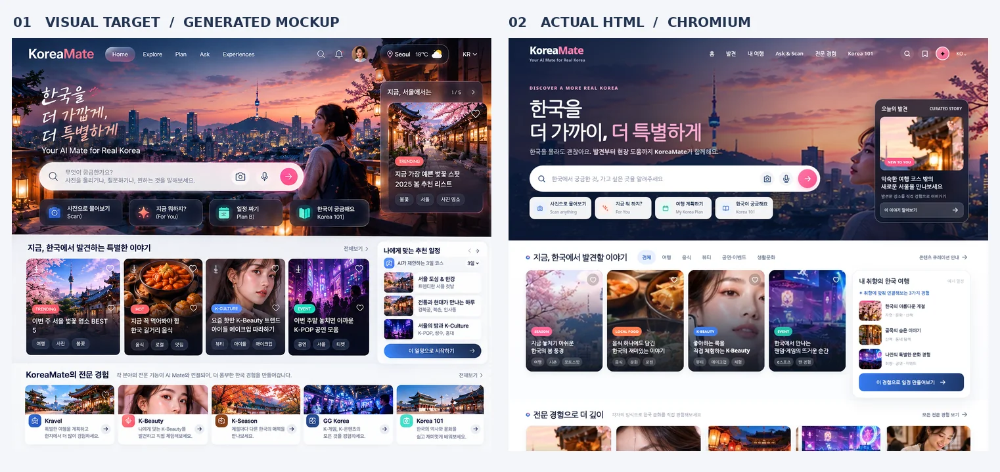

# KoreaMate · UI/UX 외부 디자인 평가 패키지 v1.0

> **외부 평가 시작점 / 반드시 이 문서부터 읽어 주세요.**  
> 문서 작성: 2026-10-18 · 자료 기준: v0.9 메인 시안(2026-10-17)  
> **상태: 기획·시각디자인 검토용 / 팀 합의 전 / 출시 서비스 아님**  
> 저장 브랜치: `docs/koreamate-experience-redesign` · 머지 대상은 추후 팀에서 결정

## 0. 한 줄로 설명하면

**KoreaMate는 한국에 처음 오거나 한국 문화에 관심 있는 외국인이, 몰랐던 K-Culture를 발견하고 사진·SNS·질문으로 이해한 다음 실제 여행·체험·현장 문제 해결까지 이어가도록 돕는 AI 동반자다.**

핵심 고민은 두 가지다.
1. KoreaMate 고유 가치(Discover, See it → Live it, Scan Anything, For You, Korea 101, Help Me Now, Plan B)를 잃지 않을 것.
2. 팀원의 전문 아이디어(Kravel, K-Beauty, K-Season, GG Korea, K-Class 등)를 단순한 메뉴 하나로 축소하지 않고 **독립적으로 깊이 있는 경험**으로 살릴 것.

이 프로젝트는 화면을 예쁘게 꾸미는 것과 여러 기능을 소개하는 것을 넘어, **문화 발견 → 도움 → 선택 → 실제 경험 → 실패 시 대안**이라는 사용자의 일을 얼마나 쉽게 만들 수 있는지가 목적이다.

## 1. 먼저 보는 화면: 최신 v0.9

**이번 평가의 기준은 v0.9이다.** 과거 v0.7·v0.8은 구조와 시각적 정체성의 탐색 과정이며, 현재 채택된 디자인 후보로 해석하지 않는다.

| 자료 | 역할 | 읽기 / 보기 |
|---|---|---|
| 디자인 목표 이미지 | 생성된 고충실도 참조 시안 — **실제 구현 화면 아님** | [기준 이미지](../assets/v0.9/reference-v0.9.webp) |
| 실제 브라우저 결과 — PC | HTML을 브라우저에서 렌더링한 화면 | [PC 캡처](../assets/v0.9/browser-desktop-v0.9.webp) |
| 실제 브라우저 결과 — 모바일 | 390px 모바일 렌더링 캡처 | [모바일 캡처](../assets/v0.9/browser-mobile-v0.9.webp) |
| 나란히 비교 | 기준 시안과 실제 HTML의 시각적 차이 | [비교 이미지](../assets/v0.9/target-vs-html-v0.9.webp) |
| HTML | 사진 데이터를 내장한 메인 한정 클릭형 시제품 | [v0.9 HTML](../previews/d-main-hifi-v0.9.html) — 원본 다운로드 후 브라우저로 열기 |

이미지는 데모 및 생성·가공 자산이다. 사진에 보이는 행사·장소·2025년 봄 관련 내용과 추천 문구는 최신 정보의 검증 결과가 아니다.

## 2. GitHub 플러그인 사용자를 위한 읽기 순서

GitHub를 연결한 AI 평가자라면 다음 **모든 자료를 이 저장소에서 직접 읽어** 주세요. 다른 프로젝트의 비슷한 문서와 혼동하지 않도록 브랜치와 경로를 고정합니다.

| 순서 | 문서 | 답할 질문 |
|---|---|---|
| **①** | **[01. 제품 문제·정체성](./01-product-context.md)** | 누구를 위해 왜 만들며, 절대 놓치면 안 되는 가치는? |
| **②** | **[02. 메인 화면설계 명세](./02-home-screen-spec.md)** | 어떤 구역과 동작이 있으며 무엇이 실제 데모인가? |
| **③** | **[03. 시각 디자인·구현 차이 분석](./03-visual-audit.md)** | 무엇이 보기 좋고 무엇이 어색하며 이전 문제가 재발했나? |
| **④** | **[04. 평가 기준과 결과 양식](./04-evaluation-rubric.md)** | 외부에서 무엇을 어떻게 비판적으로 평가할까? |
| **⑤** | **[05. AI 평가자용 요청문](./05-reviewer-request.md)** | GitHub 플러그인 사용 시 어떤 평가를 요청할까? |
| 참고 | [v0.9 구현·인계 기록](../design-handoff-v0.9.md) | 기술적/디자인적 잔여 차이와 브라우저 검증 내역 |

상위 설계·실험 자료는 [서비스 경험 v0.5](../service-experience-v0.5.md), [경험 관계도](../experience-map.md), [브랜드 가이드 초안 v0.6](../design-direction-v0.6.md), [화면 구성 A/B/C v0.7](../home-options-v0.7.md), [기각한 디자인 실험 v0.8](../brand-direction-study-v0.8.md)를 참조한다.

## 3. 이번에 평가받으려는 범위

**중점**: 현재 v0.9의 메인 UI 시각적 완성도, 정보 위계, 최초 사용자 이해도, Ask/Scan과 문화 큐레이션의 관계, PC·모바일 디자인, 전문 기능으로의 진입 가능성, 브랜드 확장성, 이미지 시안과 HTML 충실도.

**아직 평가지표로 삼지 않을 것**: 실제 AI 답변 정확도, AR 성능, 행사·지도 실시간성, 동선 최적화, 예약 실행, 팀원 전문 기능의 내부 UI 완성도. 현재 v0.9는 **메인 한 화면만 재현**했으며 전문 기능은 소개·진입 시연 수준이다.

## 4. 평가자에게 꼭 요청할 태도

- **칭찬보다 문제 발견**: 기능이 풍부하다고 무조건 좋게 보지 말고, 사용자가 과부하를 느끼는지 점검한다.
- **디자인과 UX를 분리**: 색감·사진·타이포 문제와 정보 구조·사용 흐름 문제를 구분한다.
- **원안 보호**: KoreaMate가 K-Beauty/관광 광고나 단순 서비스 모음처럼 보이는지 비판한다.
- **전문 경험 존중**: Kravel·Beauty·Season 등이 메인에서 각자 매력을 충분히 보여주는지, 그러나 메인을 장악하지는 않는지 본다.
- **근거와 영향**: 문제마다 화면 내 위치, 발생 이유, 사용자 영향, 구체적 수정 제안과 우선순위를 제시한다.
- **시연 오해 방지**: 실제 데이터처럼 보이는 예시와, 클릭만 되는 가상 기능을 명확히 구분한다.
- **이미지를 못 읽으면 정직하게**: GitHub 텍스트 도구에서 WebP 시각 확인이 불가능할 경우 이미지 파일 이름만 보고 색감·완성도를 채점하지 말고, 브라우저나 이미지 입력으로 열어 확인하도록 요청한다.

## 5. 자료 상태 및 남은 일

현재 진행 로드맵: **01 원안 확인 완료 → 02~04 경험·화면 정보 구조 초안 → 05 디자인 기준 탐색 → 06 고충실도 메인 시안(v0.9) → 07 메인 한정 HTML 재현 → 08 사용성/실데이터 검증 미완료**.

- 이 패키지는 **팀 확정본이 아닌 외부 평가를 위한 기준선(baseline)**이다.
- 평가를 받아 디자인 방향을 결정한 뒤, 전문 화면의 상세 명세와 구현을 단계적으로 진행할 예정이다.
- 메인 디자인을 마음에 든다는 이유만으로 전체 기능 개발 범위까지 확정하지 않는다.

**외부 평가의 최종 결과물:** 중요 문제 5~10개, 사용자 관점의 근거, 개선 우선순위, 메인 수정안, 디자인 시스템에 추가할 규칙, 그리고 더 확인해야 하는 질문.