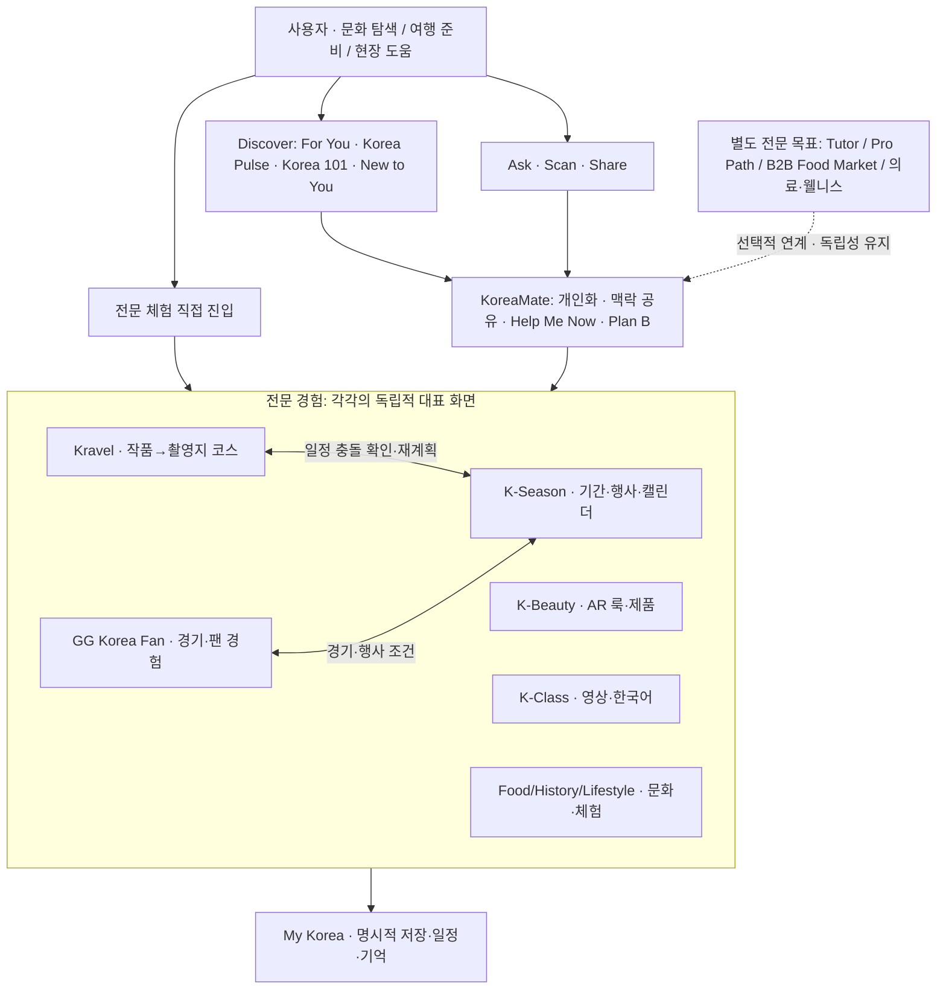

# KoreaMate 서비스 경험 구조도 v0.5

## 판정 기준
- 직접 진입: KoreaMate Scan을 거치지 않고 Kravel·Beauty 등으로 바로 들어갈 수 있다.
- 융합: 링크를 연결한 수준이 아니라 **여행 일정·의사결정 등 사용자 결과가 실제로 개선**된다.
- 디자인: 각 전문 기능의 화면을 동일 템플릿으로 획일화하지 않는다.
- 관련성이 약한 별도 사용자군은 무리하게 여행자용 메인에 편입하지 않는다.
- 이 다이어그램은 구조 초안이며 실제 데이터 흐름·성능·제휴 확정 표시가 아니다.
