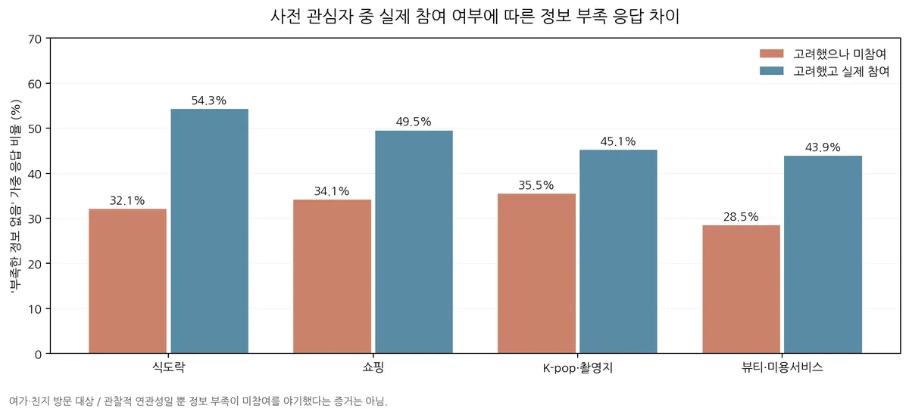
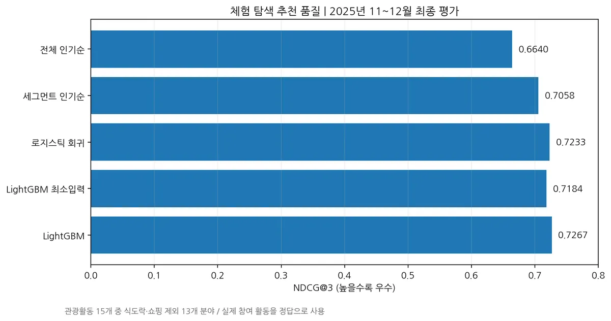
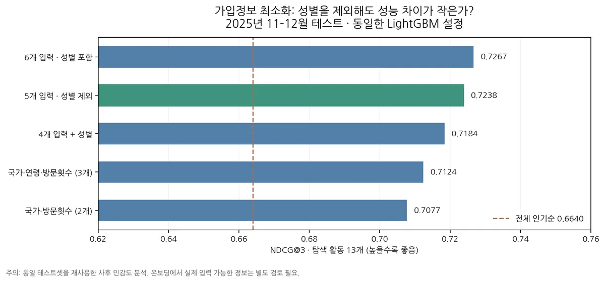

# Korea Mate | EDA 중간검토 보고서

**기준일:** 2026년 10월 15일  
**문서 상태:** 중간검토 v0.3 / 최종 프로젝트 주제 미확정  
**목적:** Korea Mate 후보의 가설·데이터 근거를 점검하고, 후속 EDA 및 검증 과제를 정리한다.  
**분석 자료:** 2025년 외래관광객조사 원자료·코드북, EDA 1차·2차 산출물 및 2026-10-15 추가 검증.

> **종합 판단:** 외국인 관광객의 활동·관심은 집단마다 다르고, 개인화는 단순 인기순보다 과거 여행활동을 잘 예측한다. 그러나 가장 중요한 문제 가설인 **'관심을 실제 행동으로 옮기는 과정의 불편'**은 아직 직접 검증되지 않았다. 데이터 분석 결과를 Korea Mate의 **후보 검증 근거**로 유지하되, 아직 제품·모델·초기 타깃을 확정하지 않는다.

## 0. 한 장으로 보는 중간 결론

| 평가 항목 | 관찰·결과 | 현재 판단 |
|---|---|---|
| 분석 기반 | 연간 응답 **16,110명**, 주 분석 집단 **12,339명** | 원자료 기반의 EDA 가능 |
| 대상 사용자 | 재방문객 **56.6%**, 전체 개별여행 **80.1%** | 단일 페르소나보다 상황별 시나리오 필요 |
| 주요 체험 | 여가·친지 집단의 식도락 **86.2%**, 쇼핑 **86.5%** | 핵심 기반 분야로 유지 |
| 관심→행동 | 사전 K-pop 장소 고려자 중 **28.1%** 미참여, 뷰티서비스 **35.8%** 미참여 | 체험 전환 과정의 추가 조사 필요 |
| 정보 불편 | 전체 응답자의 **50.3%**는 부족한 정보가 없다고 답함 | 보편적 정보 부족 주장 불가 |
| 행동 연관 | K-pop 장소→공연 동반 경험 lift **2.96** | 연관 경험 탐색에 활용 가능 |
| 군집화 | 7개 탐색 군집, 실루엣 **0.209** | 확정된 7개 페르소나 아님 |
| 개인화 추천 | 탐색 체험 NDCG@3 **0.6640 → 0.7267** | 과거 활동 예측 개선 확인 |
| 핵심 불확실성 | 실제 검색·지도·예약 이동 과정 데이터 없음 | See it → Live it 효과는 사용자 과제 필요 |
| 최신 트렌드 | 월별 활동은 있으나 실시간 팝업·장소 이용가능 정보 없음 | Korea Pulse는 별도 데이터 연구 |

**근거 구분:** '확인'은 2025년 설문에서 관찰된 사실, '간접 근거'는 행동/정보 문제와 일치하는 패턴, '가설'은 아직 측정되지 않은 사용자 경험을 뜻한다. *상대 개선 +9.4%는 NDCG@3 점수 0.6640 대비 0.0626 증가한 비율이며, 방문 전환율 증가는 아니다.*

## 1. 조사자료와 분석 품질 점검

### 1.1 데이터 구성

- **전체 16,110명 / 408개 변수:** `pnid` 중복 없음, 양의 가중치 `weight` 전원 확인. 단순 가중 유효표본크기 근사 **10,837명**.
- **주 분석 12,339명:** `Q1 in {1, 2}` = 여가·위락·휴식 또는 친지 방문 응답자. 이 집단의 단순 가중 유효표본크기 근사 **8,501명**.
- **WANT/DO/LIKE의 분모:** 사전 고려활동 `Q3_1a1..3`은 주 분석 집단에 한해 조사. 따라서 사전 고려/실제 참여/만족 활동 비교는 **동일한 12,339명**으로 제한했다.
- **응답 방식의 차이:** `Q3`(고려)와 `Q8_1`(만족)은 상위 3개 선택, `Q8`(실제 참여)은 여러 활동 선택 가능하다. `실제 참여율 - 사전 고려율`은 새로운 활동의 발견율이나 전환 효과가 아니다.
- **가중률:** `Σ(weight × 조건 일치) / Σ(weight × 해당 문항의 분석분모)`. 응답자 수 `n`은 가중 수치가 아닌 실인원이다.

**품질 판정:** 데이터 적재·기본 변수 검증·조사 대상 통일·재현 스크립트 확보는 완료. 다만 층화·집락 등 원조사의 **복합표본 분산설계까지 복원한 공식 통계 검정**은 아직 수행하지 않았다. 이하의 재표집 구간은 **근사적인 민감도 점검**이다.

### 1.2 분석 범위

| 축 | 현재 자료로 수행한 분석 | 수행하지 못한 것 |
|---|---|---|
| WHO | 국적·성별·연령·방문경험·여행유형·체류기간 | 실제 앱 이용 의사와 도입률 |
| WHAT | 사전 고려·실제 활동·만족, 화장품 구매/미용서비스 분리 | 미참여의 구체적 원인 |
| HOW | 인터넷·SNS·영상 등 정보 접촉, 세그먼트 차이 | SNS→지도→예약 실제 이동 경로 |
| FRICTION | 부족 정보 유형, 미참여 집단의 정보 부족 교차분석 | 불편 때문에 포기했다는 인과관계 |
| WHEN·WHERE | 월별 실제 참여 활동 변동 | 팝업·지역별 검색 트렌드, 실시간 가용성 |
| 추천 | 인기도/세그먼트/ML·군집·연관분석·시간분리 평가 | 실제 클릭·저장·방문 전환의 온라인 평가 |

## 2. WHO — 초기 사용자를 단일 집단으로 확정하지 않는다

전체 가중 분포 기준 **중국 28.4%, 일본 21.5%, 대만 10.7%, 미국 7.6%**. 여성 61.9%, 20~30대 56.6%, 재방문 56.6%, 개별여행 80.1%로 집계됐다. 집단 규모는 조사의 가중 보정값이며, 앱 수요·접근성·유료전환 가능성까지 나타내지는 않는다.

| 후보 세그먼트 | 실표본 n | 전체 가중 구성비 | 특징적인 실제 행동 | 추가 검증할 질문 |
|---|---:|---:|---|---|
| 중국 20대 여성 | 585 | 7.84% | 개별여행 96.9%, K-pop 관련 장소 36.0%, SNS 접촉 65.2% | 콘텐츠 발견을 실제 이동·방문으로 연결하는 불편이 있는가? |
| 일본 20대 여성 | 549 | 5.91% | 재방문 66.4%, 평균 체류 3.97일, 미용서비스 26.0% | 짧은 일정에서 경험 탐색/선택이 어려운가? |
| 대만 20대 여성 | 255 | 2.00% | 식도락 91.1%, K-pop 관련 장소 27.7% | 콘텐츠·식문화 발견의 실제 행동전환이 필요한가? |

**판정:** 초기 테스트 후보를 2~3개 유지할 근거는 충분하다. 다만 국적·연령만으로 사용자를 정형화하지 말고, 직접 고른 관심사와 방문 상황을 더 중요한 추천 단서로 검토해야 한다.

> 그림 참고: **국가·연령·성별 후보 비교** (`03_persona_comparison.png`) — 원본 PNG는 로컬 EDA 공유패키지에 있으며, GitHub에는 아직 이미지 파일이 등록되지 않았습니다.

## 3. WHAT — 관심이 실제 행동으로 이어지는가

### 3.1 같은 분모에서 비교한 활동

| 활동 | 사전 고려 상위 3개 | 실제 참여 | 만족 활동 상위 3개 | 고려자 중 미참여 |
|---|---:|---:|---:|---:|
| 식도락 | 61.7% | 86.2% | 70.0% | **6.3%** |
| 쇼핑 | 57.3% | 86.5% | 66.8% | **3.9%** |
| 자연경관 | 35.6% | 58.1% | 39.1% | 14.1% |
| K-pop·촬영지 | 17.1% | 15.9% | 12.8% | **28.1%** |
| 뷰티·미용서비스 | 12.5% | 14.1% | 9.7% | **35.8%** |
| 지역 축제 | 1.8% | 4.0% | 1.6% | 53.7% |

> 그림 참고: **고려·참여·만족 비교** (`02_what_matched_activities.png`) — 원본 PNG는 로컬 EDA 공유패키지에 있으며, GitHub에는 아직 이미지 파일이 등록되지 않았습니다.

**해석:** 이미 대중적인 식도락·쇼핑보다, 미용서비스·K-pop 관련 장소는 사전 고려자 가운데 미참여 비율이 높다. **예약이나 정보 연결이 원인일 수 있지만**, 일정 변경·선호 변화·비용·선택 제한·응답 오류도 가능하다. 지역 축제는 사전 고려자가 적어 상대비율 해석에 더 신중해야 한다.

### 3.2 Beauty는 구매와 체험을 분리해야 한다

- **향수·화장품 구매 품목 선택:** 전체 응답자 기준 **63.0%**.
- **미용서비스 활동 참여:** 전체 응답자 기준 **12.2%**.
- 따라서 화장품 쇼핑을 원하는 사용자와 미용서비스 예약/이용이 필요한 사용자는 동일한 문제가 아니다. **Beauty Shopping과 Beauty Service를 각각 가설로 관리**한다.

### 3.3 이번 중간검토에서 새로 수행한 교차분석

**질문:** 특정 활동을 사전에 고려했지만 실제로 참여하지 않은 집단은, 실제 참여한 집단보다 정보 부족을 더 보고하는가?

| 고려 활동 | 고려 후 미참여 n | 미참여자의 '정보 부족 없음' | 실제 참여자의 '정보 부족 없음' | 차이(미참여-참여) |
|---|---:|---:|---:|---:|
| 식도락 | 571 | 32.1% | 54.3% | **-22.2%p** |
| 쇼핑 | 305 | 34.1% | 49.5% | **-15.4%p** |
| K-pop·촬영지 | 562 | 35.5% | 45.1% | **-9.7%p** |
| 뷰티·미용서비스 | 485 | 28.5% | 43.9% | **-15.4%p** |

해당 차이의 응답자 단위 재표집 근사 95% 구간은 식도락 **[-26.9, -17.1]**, 쇼핑 **[-22.0, -8.4]**, K-pop **[-15.2, -3.9]**, 미용서비스 **[-21.4, -9.7]%p**로 계산됐다. **복합표본 공식 신뢰구간이 아니며, 사후 회상설문·교란 요인을 통제한 인과 추정도 아니다.** 정보 부족이 불참의 이유였다고 단정할 수 없다. 더구나 식도락·쇼핑에서도 같은 방향의 차이가 커서 특정 K-Culture 체험만의 고유 문제라고 보기 어렵다.

**제품에 연결할 다음 질문:** "가고 싶었지만 못 간 이유가 무엇인가?"를 정보 부족, 예약 방식, 운영시간, 이동, 가격, 단순 일정 변경 등으로 **직접 물어보는 사용자 인터뷰/과제 실험**이 필요하다.

## 4. HOW · FRICTION — 전반적 정보 부족보다는 상황별 문제 검증

전체 관광객의 **71.1%**는 여행 전에 인터넷 사이트·앱에서 정보를 접했고, 인터넷 접촉자 가운데 **60.0%는 SNS, 44.6%는 동영상 사이트**를 접했다. 인터넷 접촉자의 SNS 이용 60.0%는 **전체 관광객의 60.0%가 아니다**. 전체 응답자 기준 SNS는 약 **42.6%**다.

여행정보가 **부족하지 않았다는 응답은 전체 50.3%**, 여가·친지 방문 분석 집단에서는 **48.0%**였다. 전체 기준 부족 정보 유형은 교통 16.8%, 음식·맛집 12.9%, 금융 11.7%, 지역 행사 11.5%, 방문지 10.3% 등이었다(중복 응답 가능).

**판정:** 인터넷/SNS 기반 발견 경험이 널리 존재한다는 것은 확인됐다. 하지만 이용자가 앱을 몇 개 오가거나, 예약을 실패하거나, 저장한 SNS 콘텐츠를 현지 행동으로 연결하지 못했다는 **과정 데이터는 없다**. 따라서 See it → Live it은 데이터와 정합적인 **검증 가설**이지, 핵심 문제로 입증된 기능은 아니다.

## 5. 활동 연관성과 여행자 유형 — 추천 시나리오의 단서

### 5.1 연관규칙

주 분석 집단에서 관측된 가중 동반활동의 향상도(lift)는 K-pop·촬영지 → 공연 **2.96**, 전통문화체험 → 박물관·전시 **2.43**, 고궁·역사 → 전통문화체험 **2.15**였다. 이 값은 활동의 동반 발생 정도를 보여줄 뿐, 한 활동을 추천하면 다른 활동에 참여하게 된다는 뜻이 아니다.

이번 추가 검증에서 **K-pop 장소 → 공연**의 국가별 향상도는 중국 **1.69**, 일본 **4.75**, 대만 **2.48**, 미국 **3.60**이었다. 네 시장 모두 1보다 높지만 동반 참여 표본은 각각 **18명, 78명, 17명, 19명**으로 일부 집단이 작다. 세그먼트 차이와 재현성은 추가 확인이 필요하다.

### 5.2 군집 분석

가중 K-Means 3~7개 군집을 탐색한 결과 k=7에서 실루엣 **0.2086**, k=6에서 **0.2081**이었다. 차이는 매우 작다. 7개 군집의 초기값 변경 안정성 ARI가 약 **0.865**였지만, 자연적으로 뚜렷한 7가지 유형이 존재한다고 결론 내리기 어렵다.

**제품 적용 제안:** 가입 즉시 사용자를 일곱 유형 중 하나로 정하기보다, **음식·쇼핑·전통문화·K-pop·뷰티 등 관심 분야별 점수**를 여러 개 유지하고 콘텐츠 추천에 이용한다. '비슷한 여행자' 문구는 추천 기준과 분모가 실제로 설명 가능할 때 사용한다.

## 6. 개인화 ML 검토 — 가능성과 추천 여부를 구분

### 6.1 기존 모델 성능 재검토

- 학습: 2025년 1~8월 **8,194명**; 검증: 9~10월 **2,094명**; 테스트: 11~12월 **2,051명**.
- 모델 입력: 국적, 연령, 성별, 방문횟수, 여행목적, 여행형태 중 실제 사전 입력 가능한 변수만.
- 정답: 여행 완료 후 응답한 실제 참여활동. **실제 참여는 모델 입력으로 사용하지 않았다.**
- 평가 범위: 식도락·쇼핑을 제외한 **13개 탐색 체험** 중 실제 참여활동이 1개 이상인 테스트 응답자 **1,914명**. 가중 평가 대상 비중 **90.5%**.

| 방식 | 탐색 활동 NDCG@3 | 전체 인기순 대비 차이 |
|---|---:|---:|
| 전체 인기순 | **0.6640** | 기준 |
| 세그먼트 인기순 | 0.7058 | +4.18%p |
| 로지스틱 회귀 | 0.7233 | +5.93%p |
| LightGBM | **0.7267** | **+6.26%p** |

**해석:** 개인화 학습의 추가 가치는 확인된다. 그러나 **LightGBM이 로지스틱 회귀보다 0.34%p 높다**는 차이는 이번 쌍체 재표집 근사구간 **[-0.36, +1.02]%p**에서 0을 포함했다. 즉, **복잡한 모델을 확정할 근거가 부족하다.** 반면 LightGBM은 세그먼트 인기순 대비 **+2.09%p**, 근사구간 **[+1.24, +2.94]%p**였다. 모두 설문 설계를 완전히 반영하지 않은 보조 구간이며, 테스트 결과를 확인한 뒤의 탐색적 비교이므로 후속 검증이 필요하다.

### 6.2 새로 시행한 입력정보 축소 실험

동일한 훈련·테스트 기간, 고정된 LightGBM 설정으로 입력 조합만 비교했다. 이 실험은 **기존 테스트 데이터를 재사용한 사후 민감도 분석**으로, 신규 완전 독립 성능 검증은 아니다.

| 모델에 제공한 정보 | 탐색 활동 NDCG@3 |
|---|---:|
| 국가 + 방문횟수 (2개) | 0.7077 |
| 국가 + 연령 + 방문횟수 (3개) | 0.7124 |
| 국가 + 연령 + 성별 + 방문횟수 (4개) | 0.7184 |
| 국가 + 연령 + 방문횟수 + 여행목적 + 여행형태 (5개, 성별 제외) | **0.7238** |
| 위 5개 + 성별 (6개) | **0.7267** |

**새 발견:** 성별을 제외한 5개 입력 모델과 6개 모델의 차이는 **-0.29%p**, 근사 95% 구간 **[-0.90, +0.36]%p**로 차이를 확정하기 어렵다. 3개 입력도 0.7124로 전체 인기순 0.6640보다 높지만, 6개 대비 **-1.43%p**의 손실이 있다. 따라서 개인정보와 온보딩 부담을 최소화하는 대안으로 **'성별 없이 시작하고, 관심사는 직접 선택'**을 실험할 가치가 있다. 다만 실제 앱에선 방문횟수·여행목적·여행형태도 반드시 알아낼 수 있다는 보장이 없다.

### 6.3 추천을 제품 성과로 확대해석하지 않는다

NDCG@3은 **완료한 여행에서 어떤 활동을 했는가**를 상위 추천 목록으로 맞혔는지 보여준다. 새 사용자가 앱 추천을 클릭했는지, 새로운 장소를 실제로 방문했는지, 앱이 시간을 절약했는지는 나타내지 않는다. 또 탐색 활동 참여가 **0건인 약 9.5% 가중 테스트 대상**을 해당 NDCG@3 집계에서 제외했으므로, 점수를 전체 사용자 대상 성능처럼 표현해서는 안 된다.

## 7. 시간축 점검 — 활동 변화는 확인되지만 Korea Pulse 증거는 아님

주 분석 집단의 가중 참여율을 기존 훈련기간(1~8월)과 테스트기간(11~12월)으로 비교하면 **자연경관 56.6% → 65.0%(+8.4%p)**, **K-pop·촬영지 16.6% → 11.7%(-4.9%p)**, **지역 축제 3.4% → 5.8%(+2.4%p)**였다. 이는 설문 내 월별 활동 구성 변화다. **계절, 관광객 구성, 조사 시점** 등 여러 요소가 영향을 줄 수 있으므로 개별 팝업의 인기 상승이나 실시간 수요 증거가 아니다.

Korea Pulse의 검증에는 개별 행사 날짜, 운영·종료 여부, 검색 관심도 추이, 매장·위치 데이터 등 **별도 실시간/시계열 자료**가 필요하다.

## 8. 가설별 중간 판정과 후속 조사

| 가설 / 제품 요소 | 근거 수준 | 지금 말할 수 있는 것 | 다음 검증 |
|---|---|---|---|
| **H1 사용자 차이 / For You** | **관측 강함** | 집단별 실제 활동 차이, 오프라인 개인화 성능 개선 | 가입 선호·콘텐츠 선택 실험 |
| **H2 체험형 K-Culture 수요** | **관측 강함** | 음식·쇼핑·화장품 수요 높음, 미용서비스와 구분 | 핵심 시나리오 비교 |
| **H3 발견→행동의 마찰** | **간접 근거** | 관심 후 미참여·정보 부족 관련성 관찰 | 실제 미참여 이유 및 작업 흐름 실험 |
| **H4 첫 방문 vs 재방문** | **부분 지지** | 자연·박물관 등 참여 차이 | 통제 분석, 기본가이드 가치 비교 |
| **Travelers Like You** | **기술 검증 일부** | 연관 패턴과 세그먼트 기반 추천 실험 가능 | 설명 가능성·인식 평가 |
| **Korea Pulse / Local** | **미검증** | 설문만으로 최신성·지역 유행 알 수 없음 | 행사·검색·실시간 DB |
| **Context Mate** | **간접 근거** | 체류기간·여행형태 차이 존재 | 위치·남은 시간·운영상태 추천 실험 |
| **서비스 효과** | **미검증** | 사용자 과제 전후 지표 없음 | 시간, 단계 수, 성공률, 예약/방문 전환 측정 |

## 9. 다음 EDA·검증의 권장 순서

**P0. 분석 신뢰도 보강**  
국적·연령·방문경험 교차분석에서 작은 표본의 불확실성을 관리하고, 가중치와 분모를 일관되게 적용한다. 2025년 기간 밖 데이터로 추가 평가할 수 있다면 시점 일반화를 점검한다.

**P1. 사용자가 막히는 지점 조사**  
미용서비스·K-pop 장소·음식·쇼핑 등 서로 다른 과업을 대상으로 '사전 발견 → 정보 확인 → 지도/운영정보 → 예약/계획' 단계별 어려움과 미참여 이유를 직접 기록한다. 사용자가 실제로 포기한 이유는 설문만으로 추론하지 않는다.

**P2. 초기가입 입력 비교 실험**  
① 아무 입력 없는 인기순, ② 국적·방문경험 등 2~3개 입력, ③ 사용자가 직접 선택하는 관심사 2~3개, ④ 추가 정보가 있는 5~6개 입력을 같은 콘텐츠에서 비교한다. **적은 입력으로 얻는 품질, 개인정보 부담, 실제 선택 행동**을 함께 측정한다.

**P3. 활동 단위에서 장소·행사 단위로 연결**  
현재 모델은 음식·문화 등 활동 카테고리 추천이다. 실제 제품에서는 장소 ID, 주소, 영업시간, 이벤트 종료일, 출처·갱신 시점이 필요하며, 그래야 See it → Live it 시나리오가 검증 가능하다.

**P4. 트렌드 및 실시간 데이터 확보**  
검색 추이, 관광 데이터랩 관심도, 공공 행사·장소 API를 바탕으로 Korea Pulse의 '현재 인기/종료 임박/위치 근처'를 정의한다. 원자료로 검증되지 않은 실시간성은 별도 단계로 관리한다.

## 10. 팀 중간검토 회의에서 결정할 질문

1. **Korea Mate는 어떤 관광객의 어떤 행동을 돕는가?** 짧은 체류·재방문·팬덤 경험 등 복수 후보 시나리오를 비교할 것인가?
2. **핵심 사용자 문제는 실제로 정보 부족인가, 정보 연결의 번거로움인가, 예약·현지 사용의 실패인가?** 어느 지표로 검증할 것인가?
3. **개인화 기능은 반드시 ML이어야 하는가?** 세그먼트 인기순·로지스틱 회귀·LightGBM을 같은 사용자 과제에서 비교할 것인가?
4. **현재 있는 데이터로 구현 가능한 영역과 별도 데이터가 필요한 영역은?** Beauty Shopping/Service, Food, K-pop, Popup, Korea Pulse를 서로 구분해 확인할 것인가?
5. **주제 미확정 상태의 산출물 처리:** EDA는 후보 검증 보고서로 공유하되, 최종 기능·우선순위·모델 도입 결론은 팀 결정 전까지 보류할 것인가?

## 11. 자료·재현 경로와 주의사항

**기초 원자료:** 한국관광공사 / 2025 외래관광객조사 원자료 및 코드북. [원자료·코드북 안내 페이지](https://touraz.kr/statistics?bbsSeq=310809_1127&boardMode=V). 사용자가 제공한 원본 파일 기준.

**기존 EDA 자료:** `KoreaMate_2025_EDA_분석보고서.md`(1차), `KoreaMate_2025_EDA_v2_분석보고서.md`(2차), `analyze_koreamate_v2.py`, `koreamate_v2_metrics.json`.

**이번 추가 분석:** `koreamate_midreview_extension.py`(관심/참여/정보 부족·월별), `koreamate_midreview_robustness.py`(근사 구간/국가별 연관성), `koreamate_midreview_model_ablation.py`(입력축소), `koreamate_midreview_model_comparators.py`(모델 간 비교). 결과 JSON만 공유하며 **원자료나 응답자별 기록은 공유패키지에 포함하지 않는다.**

**자료 해석 주의:** 모든 통계는 2025년 설문 응답에 기반한다. 관찰된 연관성은 원인·효과를 증명하지 않는다. 부트스트랩 구간은 원조사의 전체 복합표본 구조를 재현하지 않은 보조 수치다. EDA 2차 테스트셋을 사용한 이번 후속 비교는 **독립된 신규 테스트셋이 아니라 민감도 점검**이다. 이 문서는 최종 프로젝트 주제 또는 기능 선정의 확정문이 아니다.