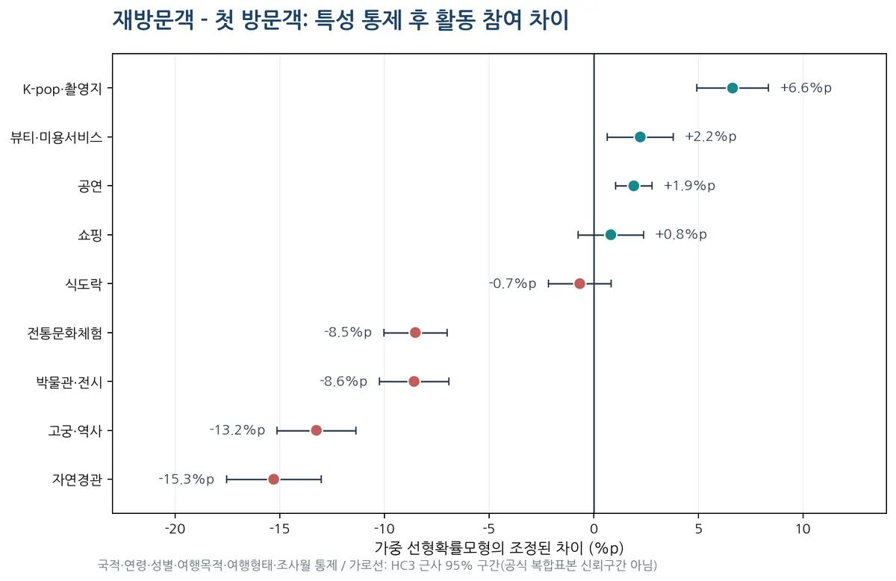
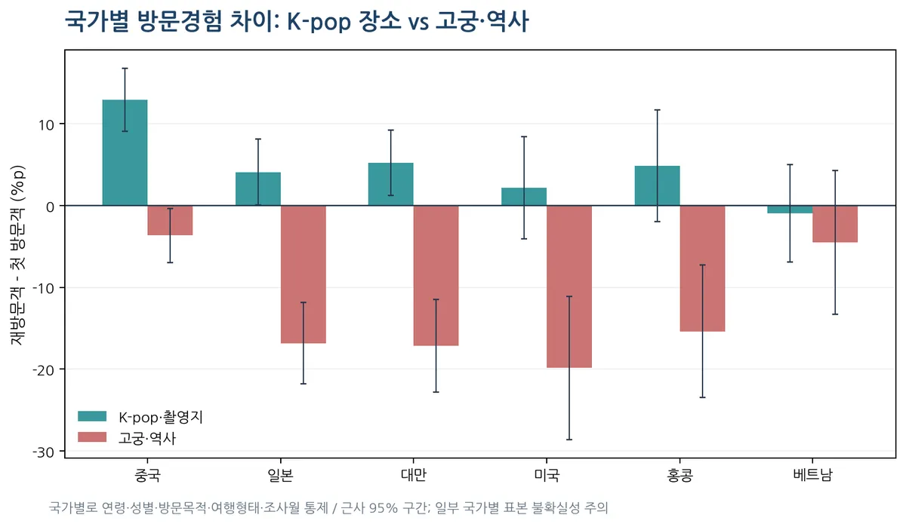
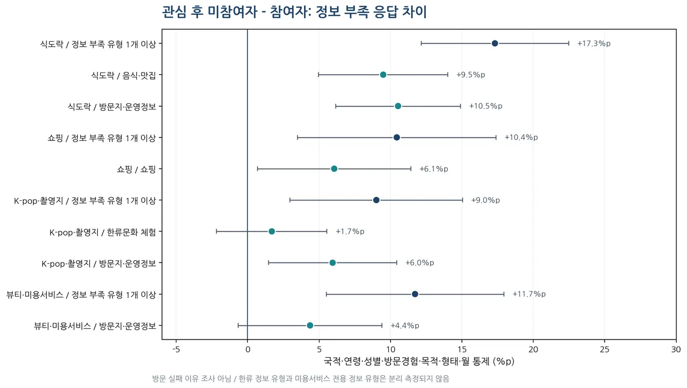
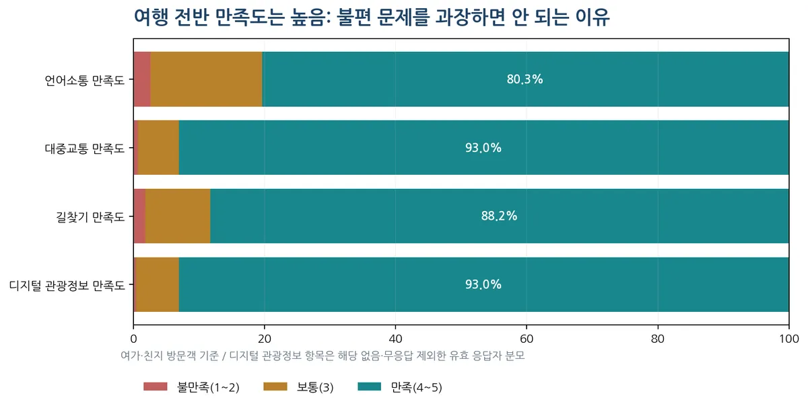

# Korea Mate · EDA 3차 심화분석

**부제:** 2025 외래관광객조사 중간검토 보완 — 방문경험 차이와 정보 부족 유형 통제분석  
**분석 기준일:** 2026년 10월 15일  
**문서 상태:** 후보 주제 검증 중 / 기능 확정 아님  
**원자료:** 사용자 제공 2025 외래관광객조사 원자료 및 코드북  
**분모:** 전체 16,110명 / 여가·친지 방문 12,339명

> **종합 판단:** 첫 방문객은 역사·자연·박물관 체험, 재방문객은 K-pop 관련 장소 참여가 상대적으로 두드러진다는 차이가 국적·연령 등을 함께 고려한 뒤에도 남아 있다. 관심 후 미참여 집단의 정보 부족 응답도 높지만, **정보 부족이 해당 활동을 포기하게 만든 원인**이라고 결론 낼 수 없다. 실제 사용자 과제에서 검증해야 한다.

## 1. 분석 질문과 방법

이번에 새로 확인한 질문은 세 가지다. (1) 첫방문/재방문의 실제 참여 차이가 다른 특성을 고려해도 남는가? (2) 같은 패턴이 모든 국적에서 나타나는가? (3) 사전에 고려했지만 실행하지 못한 활동에서 부족했던 정보가 무엇인가?

- **분석 대상:** `Q1=1 또는 2`, 여가·친지 방문 응답자 12,339명.
- **방문경험:** `D_NUM=1` 첫 방문, `2~4` 재방문.
- **가중치:** 원자료 `weight`. 가중률은 `Σ(weight×해당 응답) / Σ(weight×분모 대상)`.
- **통제 변수:** 국적, 연령, 성별, 방한 목적, 여행형태, 조사월. 정보 부족 분석에는 방문횟수 범주도 포함.
- **분석방법:** 가중 선형확률모형(LPM)과 HC3 탐색적 근사구간, 로지스틱 회귀 예측확률 표준화로 민감도 검증.
- **주의:** 원조사 층화·집락·가중치 추정의 불확실성을 반영한 **공식 복합표본 신뢰구간은 아니다**. 모든 비교는 사후 자기보고 자료에 기반한 **연관성**이며 인과추정이 아니다.

**문항 차이:** 사전 고려 활동(Q3)은 상위 3개, 실제 참여(Q8)는 다중 응답이다. 부족 정보(Q4_2)는 여행 **전체**에 대한 문항으로, 특정 활동을 포기한 원인을 직접 질문하지 않았다. 성과를 과장하면 안 된다.

## 2. 첫 방문자와 재방문자: 통제 전후 비교

다음은 **재방문객 참여율 - 첫 방문객 참여율**이다. 양수면 재방문객, 음수면 첫 방문객의 참여가 더 많다는 뜻이다.

| 활동 | 첫방문 참여 | 재방문 참여 | 단순 차이 | 조정 차이 | 근사 95% 범위 |
|---|---|---|---|---|---|
| 식도락 | 84.5% | 87.8% | +3.36%p | -0.66%p | [-2.2, +0.8] |
| 쇼핑 | 84.4% | 88.3% | +3.88%p | +0.82%p | [-0.8, +2.4] |
| 자연경관 | 68.2% | 49.1% | -19.08%p | -15.29%p | [-17.6, -13.0] |
| 고궁·역사 | 52.5% | 26.1% | -26.44%p | -13.25%p | [-15.1, -11.4] |
| 전통문화체험 | 25.7% | 9.6% | -16.06%p | -8.52%p | [-10.0, -7.0] |
| 박물관·전시 | 33.6% | 14.1% | -19.45%p | -8.58%p | [-10.2, -6.9] |
| K-pop·촬영지 | 13.5% | 18.0% | +4.46%p | +6.64%p | [+4.9, +8.4] |
| 공연 | 3.9% | 5.5% | +1.55%p | +1.92%p | [+1.1, +2.8] |
| 뷰티·미용서비스 | 12.3% | 15.6% | +3.33%p | +2.23%p | [+0.7, +3.8] |

**해석:** 고궁·역사는 단순 -26.44%p에서 통제 후 **-13.25%p**로 차이가 축소된다. K-pop 관련 장소는 단순 +4.46%p에서 통제 후 **+6.64%p**로 나타난다. 로지스틱 표준화 결과도 자연경관 -15.22%p, 고궁·역사 -13.32%p, K-pop +6.35%p로 주요 방향이 유사하다. 식도락(-0.66%p)과 쇼핑(+0.82%p)은 조정 후 차이가 작고 근사구간에 0이 포함된다.

따라서 `Korea 101`의 기본 역사·자연 안내는 첫 방문자에게 유용할 수 있지만 **재방문자에게는 로컬 장소만 추천한다**는 고정된 가정은 수정해야 한다. 재방문자에서도 팬덤·촬영지 체험이 충분히 중요할 수 있다. 방문횟수가 이런 선호를 *만들었다*고 해석할 수는 없다.

## 3. 국가별 비교: 단일 재방문 페르소나는 곤란

6개 국가를 분리하여 해당 국가 내부의 연령·성별·방문목적·형태·조사월을 통제했다.

| 국가 | 실제 n | K-pop 조정 차이 | 근사 95% 범위 | 고궁·역사 조정 차이 |
|---|---|---|---|---|
| 중국 | 1849 | +12.90%p | [+9.0, +16.8] | -3.66%p |
| 일본 | 1710 | +4.06%p | [+0.0, +8.1] | -16.86%p |
| 대만 | 1251 | +5.25%p | [+1.2, +9.2] | -17.17%p |
| 미국 | 778 | +2.18%p | [-4.1, +8.4] | -19.87%p |
| 홍콩 | 734 | +4.84%p | [-2.0, +11.7] | -15.38%p |
| 베트남 | 567 | -0.95%p | [-6.9, +5.0] | -4.51%p |

중국의 K-pop 관련 장소는 재방문자가 **+12.90%p** 더 많이 참여했고 일본 +4.06%p, 대만 +5.25%p로 같은 방향이었다. 미국 +2.18%p와 베트남 -0.95%p의 근사구간은 0을 포함한다. 특정 국가·연령·성별을 하나의 고정 성향으로 취급하기보다 **직접 선택한 관심사와 맥락**을 함께 고려하는 것이 타당하다. 하위집단별 표본 수가 작아지면 해석에 특히 주의해야 한다.

## 4. 관심 후 미참여와 정보 부족의 연관

사전 고려(Q3 상위 3개) 집단에서 실제 참여한 사람과 미참여한 사람을 나누어, 부족했던 여행정보가 하나 이상 있었는지를 비교했다. 조정 모델에는 방문횟수도 추가로 통제했다.

| 고려 활동 | 고려 n | 미참여 n | 미참여 정보 부족 | 참여 정보 부족 | 조정 차이 | 로지스틱 검산 |
|---|---|---|---|---|---|---|
| 식도락 | 6934 | 571 | 67.9% | 45.7% | +17.31%p | +17.59%p |
| 쇼핑 | 6667 | 305 | 65.9% | 50.5% | +10.44%p | +10.82%p |
| K-pop·촬영지 | 1831 | 562 | 64.5% | 54.9% | +9.01%p | +9.07%p |
| 뷰티·미용서비스 | 1453 | 485 | 71.5% | 56.1% | +11.72%p | +11.83%p |

식도락 **+17.31%p**, 쇼핑 +10.44%p, K-pop 관련 장소 +9.01%p, 미용서비스 +11.72%p였다. 로지스틱 모형에서도 같은 방향이므로 특정 회귀모형만의 결과로 보기는 어렵다. 그러나 **네 영역 모두에서 관찰되므로 K-pop/뷰티만의 고유한 문제라는 근거는 아니다.** 여행정보에 대한 민감도, 여행 동선, 선호 변화 등 다른 이유가 설명할 수 있다.

### 실제 부족 정보의 종류

| 고려 활동 | 부족한 정보 | 미참여 응답률 | 참여 응답률 | 조정 차이 | 근사 95% 범위 |
|---|---|---|---|---|---|
| 식도락 | 음식·맛집 | 21.5% | 10.3% | +9.49%p | [+5.0, +14.0] |
| 식도락 | 방문지·운영정보 | 21.7% | 9.7% | +10.53%p | [+6.2, +14.9] |
| 쇼핑 | 쇼핑 | 15.8% | 10.7% | +6.06%p | [+0.7, +11.4] |
| K-pop·촬영지 | 한류문화 체험 | 11.9% | 9.0% | +1.69%p | [-2.2, +5.5] |
| K-pop·촬영지 | 방문지·운영정보 | 17.4% | 11.9% | +5.95%p | [+1.5, +10.4] |
| 뷰티·미용서비스 | 방문지·운영정보 | 16.4% | 10.6% | +4.37%p | [-0.7, +9.4] |

K-pop 고려 후 미참여 집단에서 **한류 정보 부족(+1.69%p)**은 근사구간이 0을 포함하는 반면, **방문지·운영정보(+5.95%p)**는 상대적으로 차이가 컸다. 이는 콘텐츠 설명에 비해 운영시간·장소·입장 방식 같은 정보를 실제로 확인하는 과제가 유용할 수 있다는 **제품 가설**이다. 다만 Q4 정보부족은 해당 K-pop 장소 전용 응답이 아니라 **전체 여행**을 가리킨다.

미용서비스의 '예약방법·가격·언어'에 대한 직접 문항은 코드북에 없다. 쇼핑 정보 부족을 그대로 미용서비스 예약 실패 원인으로 대체해서는 안 된다.

## 5. 만족도는 대체로 높다: 보편적 불편 주장의 반증 근거

Q12의 매우 불만족(1)~매우 만족(5)을 재집계했다. '해당 없음(0)'·'모름(9)' 응답은 유효 분모에서 제외했다.

| 만족도 항목 | 유효 n | 불만족(1~2) | 보통(3) | 만족(4~5) |
|---|---|---|---|---|
| 언어소통 만족도 | 12339 | 2.6% | 17.1% | 80.3% |
| 대중교통 만족도 | 12339 | 0.7% | 6.3% | 93.0% |
| 길찾기 만족도 | 12339 | 1.8% | 10.0% | 88.2% |
| 디지털 관광정보 만족도 | 11761 | 0.4% | 6.5% | 93.0% |

길찾기 만족 응답 **88.2%**, 대중교통 **93.0%**, 디지털 관광정보 **93.1%**, 언어소통 **80.3%**였다. 따라서 '모든 외래관광객은 여행정보가 불충분해 불편하다'고 말할 근거는 없다. 동시에 특정 사용자·특정 과업에서 어려움을 겪는 사례가 존재할 수 있으므로 **핵심 사용자 문제를 더 구체적으로 설정하는 것이 필요**하다.

## 6. 후보 기능별 해석과 남은 검증

| 후보 기능 | 데이터에서 관찰된 것 | 데이터만으로 확인되지 않는 것 |
|---|---|---|
| Korea 101 | 첫 방문객의 자연·역사·전시 참여 우세 | 기본 안내 자체가 부족한가? |
| For You | 국가·방문횟수에 따른 활동 차이, 기존 ML 추천 평가 | 가입자의 관심사가 실제 장소 선택으로 이어지는가? |
| See it → Live it | 관심 후 미참여·정보 부족 연관 | 정보 부족 **때문에** 방문을 포기했는가? |
| K-pop 가이드 | 일부 국가 재방문객의 K-pop 관련 장소 참여 우세 | 어떤 장소/예약/시간 정보가 실제 필요한가? |
| Beauty Service | 고려 후 미참여자 존재 | 예약·가격·언어가 실제 장애인가? |
| Korea Pulse | 이 설문만으로 최신 지역 행사·팝업 수요 측정 불가 | 실시간 검색·행사·장소 데이터 필요 |

이 결과는 Korea Mate의 주제를 확정하거나 기능을 강제로 축소하기 위한 것이 아니다. 후보별로 **어떤 증거가 있고, 어떤 증거가 없는지** 구분하기 위한 중간검토다.

## 7. 다음 단계: 사용자가 실제 막히는 지점을 테스트

**A. 촬영지 방문 계획:** SNS 스크린샷을 주고 장소의 정확한 이름·위치·운영시간·이동 방법을 찾아 일정에 추가하도록 한다. 기존 검색방식 대비 과제시간·단계 수·정답 정확도·정보 최신성을 기록한다.

**B. 미용서비스 방문/예약:** 이용하려는 서비스를 찾고 가격, 예약 여부, 이용 언어를 확인한다. 예약이 안 되거나 불확실할 때도 잘못된 확답을 하지 않는지 평가한다.

**C. 첫 방문객 기본 안내:** 교통, 매장 이용법, 방문지의 현장 규칙을 처음 접하는 사용자가 얼마나 쉽게 이해하고 실제 계획을 구성하는지 측정한다.

첫 탐색 실험에는 서로 다른 언어권과 방문경험의 **5~8명**을 모집해 행동 경로와 포기 이유를 관찰할 수 있다. 이 규모는 탐색적 문제 발견을 위한 예시이며, 통계적으로 시간 개선율을 일반화하는 표본이 아니다. 사용자 테스트의 시간·정확도 수치는 **실험 후** 기록한다.

## 8. 한계·재현 및 다음 의사결정

1. **관측적 자료:** 모든 응답은 여행 후 단면조사다. 재방문이 특정 관심을 *유발했다*거나 정보 부족이 미참여를 *초래했다*고 주장할 수 없다.
2. **표본 구조:** 공개 가중치를 적용했지만 공식 복합표본 분산 추정 절차를 완전 복원하지 않았으며 HC3 구간은 탐색용이다.
3. **문항 차이와 선택 편향:** 사전 고려 Q3은 상위 3개, 참여 Q8은 복수응답. Q3 선택자 하위집단을 전체 방문객과 동일시하지 않는다.
4. **다중 탐색:** 여러 활동·시장·정보유형을 병렬 비교했다. 개별 근사구간이 0을 제외하더라도 독립적으로 재확인해야 한다.
5. **ML 결과와 구분:** 이전 EDA의 NDCG는 사후 실제 참여활동 예측이며, 앱 클릭·예약·실제 방문 전환율은 아직 측정하지 않았다.

**재현:** 사용자 보유 원자료에서 생성한 `2025_eda_raw.csv`가 있는 환경에서 `koreamate_eda_v3_controls.py` 및 `koreamate_v3_logit_sensitivity.py`를 실행한다. NumPy와 scikit-learn이 필요하다. 이 보고서·그림·CSV·엑셀은 **집계값만 포함**하며 응답자 수준 원자료는 공유하지 않는다.

**출처:** 한국관광공사, 2025 외래관광객조사 사용자 제공 원자료 및 코드북. [공식 안내](https://touraz.kr/statistics?bbsSeq=310809_1127&boardMode=V). 추가 집계 기준일 2026.10.15.