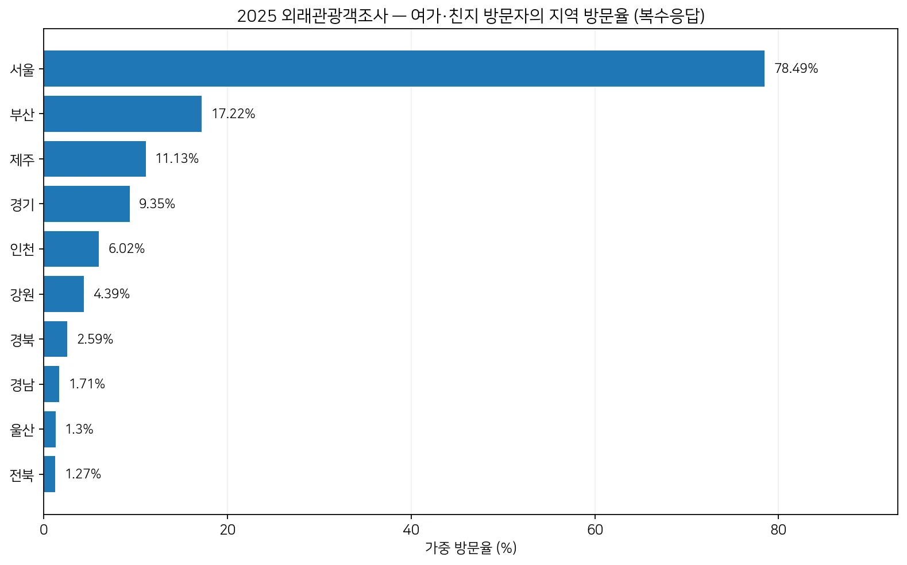
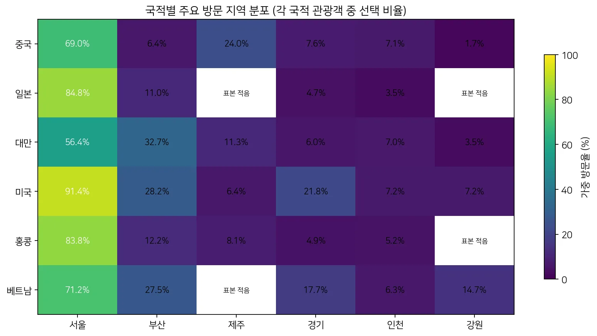
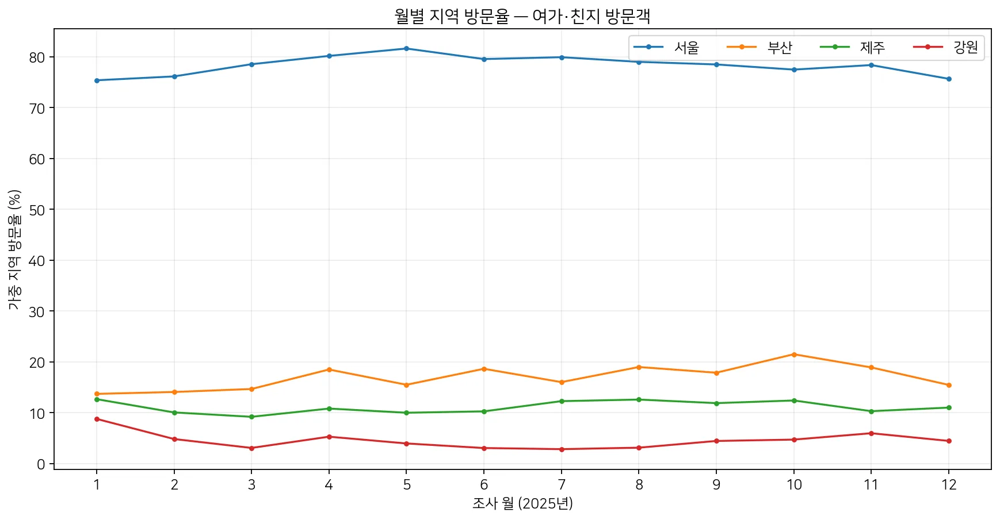
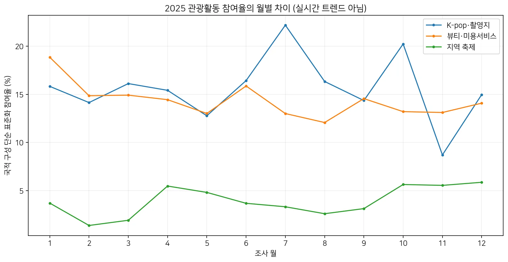

# Korea Mate | EDA 4차: 통합 품질검증 및 WHEN & WHERE 1차 분석

**분석 대상:** 2025년 외래관광객조사 원자료(16,110명, 408개 변수) / 2026-10-16 기준

**상태:** Korea Mate는 최종 프로젝트 후보. 아래 결과는 검증용 분석이며 주제·기능 확정 결정이 아님.

## 0. 결론 요약

- **기존 EDA의 핵심 수치는 재현됐고, 설문 월·분기·가중치·지역 선택 코드에서 구조적 오류를 발견하지 못했다.**
- 여가·친지 방문객 중 지역 방문은 **서울 78.49%, 부산 17.22%, 제주 11.13%** 순서였다. **73.78%는 1개 지역, 26.22%는 2개 이상 지역을 방문**했다.
- 국적별로 서울·부산·제주 등 방문 분포가 다르다. 다만 조사 구성과 방한 경로 등의 영향을 통제하지 않은 **관찰 결과**다.
- 2025년 조사 월별 차이가 존재하지만 한 해의 응답 결과만으로 **지속적인 검색 트렌드나 특정 행사의 인기**를 증명할 수 없다.
- 다음 분석은 **다년간 지역·국적 자료와 실제 행사/장소 운영정보**가 필요한지 검증하는 단계다.

## 1. 통합 품질검증 (STEP 9)

| 검증항목 | 결과 |
| --- | --- |
| 행/열 수 | 16,110행 · 408개 변수 |
| ID 중복 | 0건 |
| 통합 가중치 | 유효 / 합 15,876,198 |
| 월과 분기 일치 | True |
| 분기별 가중치 구성 | [True, True, True, True] |
| 방문 지역 선택코드 | 오류 0건 |
| 관광활동 선택코드 | 오류 0건 |
| 지역 응답 누락 | 0명 |
| 여가·친지 방문집단 | 12,339명 / 가중 근사 유효표본크기 8,501.3 |

### 기존 보고서 수치 대조

| 지표 | 기존 보고서 | 원자료 재계산 | 차이 | 판정 |
| --- | --- | --- | --- | --- |
| 전체 응답자 | 16110 명 | 16110 명 | 0.0 | 일치 |
| 변수 수 | 408 개 | 408 개 | 0.0 | 일치 |
| 여가·친지 표본 | 12339 명 | 12339 명 | 0.0 | 일치 |
| 여성 가중 구성비 | 61.94 % | 61.94 % | 0.0 | 일치 |
| 20대 가중 구성비 | 31.64 % | 31.64 % | 0.0 | 일치 |
| 30대 가중 구성비 | 24.98 % | 24.98 % | 0.0 | 일치 |
| 재방문율 | 56.57 % | 56.57 % | 0.0 | 일치 |
| 개별여행률 | 80.14 % | 80.14 % | 0.0 | 일치 |
| 식도락 전체 활동 | 81.57 % | 81.57 % | 0.0 | 일치 |
| 쇼핑 전체 활동 | 80.31 % | 80.31 % | 0.0 | 일치 |
| 뷰티·미용서비스 전체 활동 | 12.16 % | 12.16 % | 0.0 | 일치 |
| K-pop·촬영지 전체 활동 | 13.51 % | 13.51 % | 0.0 | 일치 |

### 재실행 검증

- EDA v2 개인화·연관·군집 전체 JSON 재실행: **완전 일치**. 탐색 체험 LightGBM NDCG@3 = **0.726682**.
- EDA v3 통제분석 전체 JSON: **완전 일치**.
- 로지스틱 민감도 검산 수치: **일치**. 단, 최적화 반복 횟수는 2개 결과에서 차이가 있었다.
- 주요 주의: 통제분석의 HC3 구간은 **공식 복합표본 설계 기반 추론이 아니다**. 특정 활동 미참여의 원인도 입증하지 않는다.

## 2. 방문 지역 현황 (STEP 10 / WHERE)

**분모:** 여가·위락·휴식 또는 친지 방문자 12,339명. **Q9_2 지역별 복수응답**, 가중 비율. 17개 지역의 합은 100%가 아닐 수 있다.

| 순위 | 지역 | 실제 응답 n | 가중 방문율 |
| --- | --- | --- | --- |
| 1 | 서울 | 10166 | 78.49% |
| 2 | 부산 | 2464 | 17.22% |
| 3 | 제주 | 1121 | 11.13% |
| 4 | 경기 | 1411 | 9.35% |
| 5 | 인천 | 770 | 6.02% |
| 6 | 강원 | 821 | 4.39% |
| 7 | 경북 | 377 | 2.59% |
| 8 | 경남 | 225 | 1.71% |
| 9 | 울산 | 159 | 1.3% |
| 10 | 전북 | 175 | 1.27% |
| 11 | 대구 | 146 | 0.95% |
| 12 | 전남 | 83 | 0.55% |
| 13 | 광주 | 86 | 0.49% |
| 14 | 대전 | 71 | 0.45% |
| 15 | 충북 | 52 | 0.41% |
| 16 | 충남 | 39 | 0.25% |
| 17 | 세종 | 17 | 0.11% |



### 방문 지역 개수

| 방문 지역 수 | 가중 비율 |
| --- | --- |
| 1개 | 73.78% |
| 2개 이상 | 26.22% |
| 3개 이상 | 7.06% |
| 가중 평균 | 1.367개 |

> `3개 이상`은 `2개 이상`에 포함되는 부분집합이므로 100% 합산표로 해석하지 않는다. 지역 간 이동 순서는 원자료에서 확인되지 않는다.

## 3. 국적별 주요 방문 지역 차이

| 국적 | 서울 | 부산 | 제주 | 경기 | 인천 | 강원 |
| --- | --- | --- | --- | --- | --- | --- |
| 중국 | 69.05% | 6.44% | 23.98% | 7.56% | 7.06% | 1.71% |
| 일본 | 84.81% | 11.01% | 표본 적음 | 4.65% | 3.5% | 표본 적음 |
| 대만 | 56.4% | 32.66% | 11.32% | 6.03% | 7.01% | 3.48% |
| 미국 | 91.4% | 28.18% | 6.38% | 21.78% | 7.24% | 7.2% |
| 홍콩 | 83.75% | 12.22% | 8.14% | 4.89% | 5.21% | 표본 적음 |
| 베트남 | 71.2% | 27.5% | 표본 적음 | 17.7% | 6.26% | 14.67% |



사례: 대만 방문객 중 **부산 방문율 32.66%**, 미국 방문객 중 **경기 21.78%**, 중국 방문객 중 **제주 23.98%**로 차이가 관찰됐다. 이는 **국적별 실제 선호의 인과적 차이 또는 앱 사용 수요**가 아니라 관찰된 방문 비율이다.

작은 집단의 우연 변동이나 식별 위험을 줄이기 위해 **특정 국가·지역 조합의 실제 방문 응답 n이 30 미만이면 비율을 공개하지 않았다.**

## 4. 조사 월별 방문과 체험 패턴 (WHEN)

### 대표 지역별 월별 방문율



- **서울**: 1월 75.36% ~ 5월 81.6% (해당 월 원자료에서 관찰된 방문응답의 차이).
- **부산**: 1월 13.7% ~ 10월 21.49% (해당 월 원자료에서 관찰된 방문응답의 차이).
- **제주**: 3월 9.19% ~ 1월 12.66% (해당 월 원자료에서 관찰된 방문응답의 차이).
- **강원**: 7월 2.83% ~ 1월 8.78% (해당 월 원자료에서 관찰된 방문응답의 차이).

월별 집계에서 **국적 구성 변화만 통제**하려고 중국·일본·대만·미국·홍콩·그 외 집단의 **연간 가중 구성비로 직접 표준화한 비교값**도 계산했다. 다른 변수의 차이는 남아 있으므로 인과적인 월 효과로 해석하면 안 된다.

### 활동별 월별 가중 참여율·국적 구성 표준화



| 대상 | 월 | 원자료 가중 참여율 | 국적 구성 표준화 |
| --- | --- | --- | --- |
| K-pop·촬영지 | 7 | 24.28% | 22.17% |
| K-pop·촬영지 | 11 | 8.47% | 8.71% |
| 지역 축제 | 4 | 6.29% | 5.48% |
| 지역 축제 | 10 | 6.01% | 5.64% |
| 뷰티·미용서비스 | 1 | 17.84% | 18.84% |
| 뷰티·미용서비스 | 8 | 11.67% | 12.07% |

K-pop 관련 장소 참여는 7월 24.28%, 11월 8.47%였고 국적 구성 표준화 시 각각 22.17%, 8.71%다. 그러나 **한 해의 조사 월별 사후 보고**만으로 수요 상승세·유행 가속도·콘텐츠 최신성은 검증할 수 없다.

## 5. 지역 동반 방문 (참고)

| 동반 방문 지역 | 가중 동반 방문율 | Lift | 표본 n |
| --- | --- | --- | --- |
| 서울 + 부산 | 8.87% | 0.656 | 1529 |
| 서울 + 경기 | 7.95% | 1.083 | 1216 |
| 서울 + 인천 | 4.45% | 0.943 | 597 |
| 서울 + 강원 | 4.18% | 1.211 | 782 |
| 서울 + 제주 | 2.43% | 0.278 | 441 |
| 경북 + 부산 | 2.28% | 5.116 | 319 |
| 경기 + 강원 | 1.67% | 4.077 | 329 |
| 경기 + 인천 | 1.36% | 2.416 | 205 |

Lift는 독립적 방문을 가정한 기대 비율에 비해 같은 사람이 두 지역을 방문한 비율이 얼마나 큰지 나타낸다. **이동 순서·교통 접근성·일정 최적 경로를 의미하지 않는다.**

## 6. 제품 기획으로 연결할 수 있는 것 / 아직 연결할 수 없는 것

| 관측 | 가능한 기획 가설 | 현재 검증 수준 |
| --- | --- | --- |
| 서울 78.49%, 단일 지역 방문 73.78% | 같은 지역 내 장소 탐색·근거리 일정 지원 | 지역 기반 추천 후보, 서비스 효과 미검증 |
| 2개 이상 지역 방문 26.22% | 다지역 이동·체류기간 기반 일정 지원 | 동선·방문순서 정보 없어 추가 데이터 필요 |
| 국적별 지역 구성 차이 | 국적/방문경험을 활용한 기본 추천 | 실제 선호는 자기선택·정보환경 영향 가능 |
| 월별 관광활동 참여율 차이 | 추천 화면의 계절별 컨텐츠 묶음 | 단일 연도. 최신 트렌드 설명 불가 |
| K-pop 참여·지역방문 응답 동시 관측 | 특정 지역 K-pop 장소 후보 탐색 | 해당 활동이 그 지역에서 이루어진 것인지 모름 |

### 현재 데이터로 주장하면 안 되는 것

1. **"서울에서 K-pop 관광이 많았다"** — Q9(방문 지역)와 Q8(참여 활동)이 장소별로 연결되지 않는다.
2. **"2025년 7월 특정 팝업이 뜨고 있었다"** — 자료에 개별 행사·영업기간·장소 메타데이터가 없다.
3. **"지역별 방문 비율이 순방문객 점유율이다"** — 방문 지역은 복수응답이다.
4. **"국적별 차이가 서비스 개인화 효과를 증명한다"** — 데이터는 과거 관광활동의 사후 자기보고다.
5. **"이 분석으로 최단 이동 경로를 제시할 수 있다"** — 개별 방문 장소/시간/동선이 없다.

## 7. 다음 연구 순서 (검증과 제품 의사결정 구분)

| 우선 | 추가 분석 과제 | 필요 데이터 | 산출물·완료 기준 |
| --- | --- | --- | --- |
| A | 2023~2026 다년 비교로 시계열 타당성 확인 | 연도별 공식 외래관광객조사·지역 통계 | 같은 문항/분모/가중치 정의로 비교 가능한 값만 추출 |
| B | 실제 행사·체험·운영 정보 확보 | 관광/지자체 행사 Open API, 장소·주소·영업시간·종료일 | 시간·지역·언어별 결측률/신선도/제공 조건 검증 |
| C | 실제 장소 단위 추천을 위한 지리·동선 정보 | POI 좌표, 이동 시간, 이용 조건 | 실행 가능한 추천 후보 커버리지와 오류율 측정 |
| D | AI 개인화 모델 실제 사용 검증 | 사용자 선호 설문, 저장·계획·방문 이벤트 | 오프라인 NDCG와 온라인 행동 성과 분리 비교 |
| E | 사용자 과제 3종 A/B 비교 | SNS 촬영지, 미용서비스 준비, 첫 방문 안내 | 작업완료율·시간·오류·도움 정도로 문제 검증 |

**의견:** A~E는 연구 가능 범위이며, 어느 기능부터 만들지 결정한 것이 아니다. Korea Mate 채택 여부는 팀의 후보 비교 단계에서 별도로 판단한다.

## 8. 다음 분석을 위한 외부 데이터 확보 가능성 확인

2026-10-16에 공공데이터포털 및 한국관광 데이터랩에서 **데이터 설명과 제공 기능의 존재**를 확인했다. API 인증키 발급·호출·응답 스키마 검증 및 품질 측정은 아직 진행하지 않았다.

| 공공 데이터 후보 | 확인한 제공 범위 | 검증이 필요한 항목 | 확인 자료 |
| --- | --- | --- | --- |
| 한국관광공사 국문 관광정보 서비스(KorService2) | 지역·위치 기반 관광정보, 행사 조회(searchFestival2), 공통·소개·이미지 정보 | 장소 좌표, 행사 시작/종료일, 소멸/취소 반영, 다국어, 저작권·호출 한도 | [공공데이터포털](https://www.data.go.kr/data/15101578/openapi.do) |
| 지역별 관광 자원 수요 API | SNS 언급량·소비·내비게이션 기반 관광 서비스 및 문화자원 수요 지표 | 지표 의미, 업데이트 주기, 지역코드 호환성, 이용제한 | [공공데이터포털](https://www.data.go.kr/data/15152138/openapi.do) |
| 관광 데이터랩 | 국가별·지역별 분석, 이동통신·카드·내비 데이터 | 지표별 갱신 지연, 원자료 접근, 설문과 다른 모집단 | [갱신주기 안내](https://datalab.visitkorea.or.kr/datalab/portal/getMetaInfoList.do) |

**해석:** 이벤트·장소 데이터와 지난 관광행동 조사는 서로 다른 출처이므로 바로 행 단위로 결합할 수 없다. 먼저 `지역코드`, `시점`, `장소 식별자`, `행사 상태`, `자료 갱신일`, `사용권한`의 호환 여부를 표준화해야 한다. 데이터랩의 '업데이트 주기'와 실제 장소의 '영업 상태 최신성'도 별개다.

---

## 9. 재현 방법 및 보안

```bash
python -m pip install numpy matplotlib
python analysis/koreamate_step9_10_audit.py --input /PRIVATE/2025_eda_raw.csv --out outputs/
python analysis/create_eda_charts.py
```

코드북 원본의 지역 Q9_2a01~17, 활동 Q8, 조사 월 D_MON, 월별 가중치 weight를 대조하여 범주 매핑을 구성했다. 원자료 ZIP·XLSX·응답자별 CSV는 GitHub·공유패키지에서 제외한다. 지역·국가의 방문 n이 30 미만인 표는 공개용 CSV에서 비율을 가린다.

**출처:** 사용자 제공 「2025년 외래관광객조사」 원자료·코드북. [공식 자료 안내](https://touraz.kr/statistics?bbsSeq=310809_1127&boardMode=V). 본 보고서는 제3자 외부 트렌드 데이터를 아직 결합하지 않았다.
